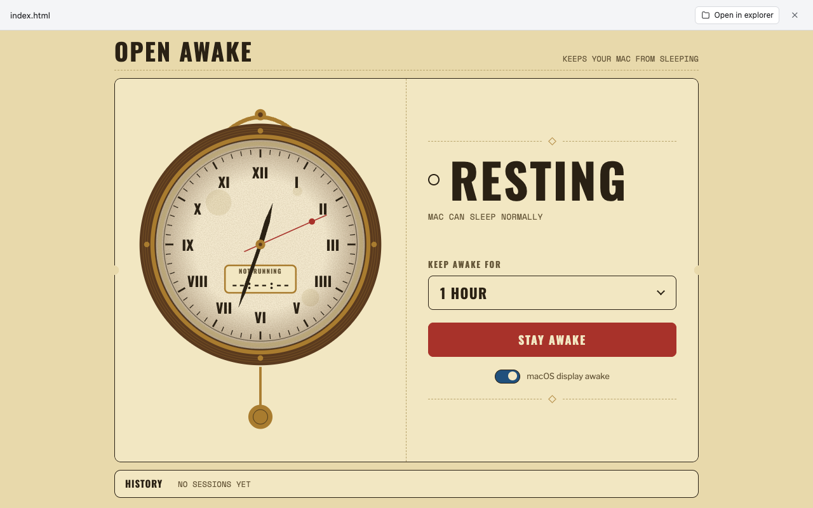

# Open Awake

Keep your Mac from sleeping, forever or for a set time. Pick a duration
(15 minutes to 8 hours, or until you stop it), press **Stay awake**, and the
Mac won't idle-sleep until time is up or you press **Stop**. It's an
Amphetamine-style wrapper around macOS's own `caffeinate`.

- A vintage wall clock shows the remaining time, and its pendulum swings while
  the Mac is held awake.
- Optional switch to keep the display on.
- History of recent sessions and today's total awake time.
- Sessions survive closing the tab. A small background daemon (`awake.py`)
  owns `caffeinate -w`, so it never leaves an orphaned process.

> macOS only. A MacBook with the lid closed on battery still sleeps; that's
> an OS rule. Stdlib Python, no dependencies.
